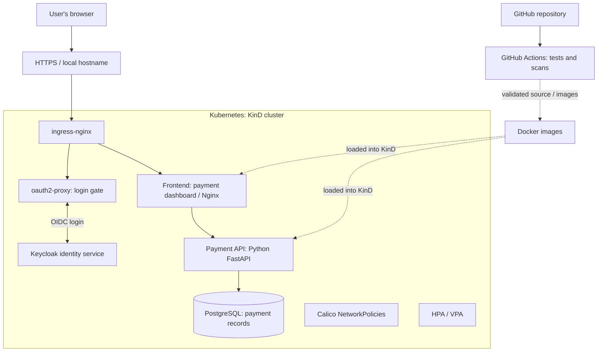

# 🛡️ AegisShield — Secure Kubernetes DevSecOps Platform

> **Learn by building:** Docker + Kubernetes + Helm + CI/CD + a Payment API + PostgreSQL + login security + autoscaling + network protection.
>
> **Project status:** Completed as a learning and portfolio project. **Experimental API image `1.0.6-test4` is on HOLD and must not be promoted to production without a security decision.**

## Table of Contents

1. [Project Overview and Objectives](#1-what-is-this-project)
2. [Architecture Overview](#2-architecture-how-the-pieces-connect)
3. [Prerequisites](#3-what-you-need-before-starting)
4. [Repository and Initial Setup](#4-get-the-project-and-inspect-it)
5. [Infrastructure Setup — Kubernetes, Calico, Metrics](#5-build-the-kubernetes-playground)
6. [Application Components](#6-understand-the-application)
7. [Docker Image Build and Validation](#7-build-and-check-docker-images)
8. [Helm Deployment and Autoscaling](#8-deploy-with-helm-existing-lab-workflow)
9. [Browser Access and Authentication](#9-open-the-dashboard-in-a-browser)
10. [CI/CD Pipeline](#10-cicd-automatic-checks-on-github)
11. [Testing and Validation](#11-all-major-testing-stages-what-was-done-and-why)
12. [Troubleshooting Guide](#12-troubleshooting-diary-problems-we-actually-encountered)
13. [Diagnostic Command Reference](#13-useful-troubleshooting-command-cheat-sheet)
14. [Security Best Practices and Release Decision](#14-security-investigation-why-the-candidate-is-still-on-hold)
15. [Final Results and Evidence](#15-final-project-state-and-evidence)
16. [Future Improvements](#16-what-would-i-do-next-in-a-real-company)
17. [Key Learnings](#17-what-you-learned)
18. [Contributing](#18-contributing)

---

## 1. What is this project?

Imagine you own a small online shop. A customer opens the website, signs in, and asks the shop to make a **pretend payment**. The shop needs a website, a computer program that handles payment requests, and a database that remembers the requests. It also needs guards to stop strangers from entering private areas.

**AegisShield** is that shop's practice system. It is **not a real payment processor**: its `/pay` endpoint records a simulated successful payment; it does not charge a card or move money.

The main lesson is how to run, protect, test, and update a web application using tools used by DevOps engineers.

### Project objective

Design, deploy, automate, test, and secure a **cloud-native application platform** with Docker, Kubernetes, Helm, and DevSecOps tools. The platform demonstrates a simulated payment workflow, access control, multi-node orchestration, and secure communication between services.

### Key technical objectives

1. **Containerization:** Build and validate reproducible Docker images for the Payment API.
2. **Orchestration:** Run frontend, API, databases, and identity services in a three-node KinD cluster.
3. **Infrastructure automation:** Manage Kubernetes workloads and configuration through Helm charts.
4. **Autoscaling:** Configure HPA for frontend/API replica scaling and VPA in recommendation-only mode; do not claim load-triggered scaling was proven.
5. **Authentication:** Protect application access using Keycloak and OAuth2 Proxy.
6. **Network isolation:** Use Calico and default-deny NetworkPolicies with explicit permitted traffic.
7. **Persistence:** Use PostgreSQL StatefulSets for application and identity data.
8. **CI/CD and security:** Apply automated tests, Python dependency and source scans, container scans, and controlled release decisions.
9. **Troubleshooting:** Diagnose browser routing, HTTP errors, Pod startup, database connectivity, DNS, and network access.
10. **Evidence:** Record both successful tests and unresolved risks without claiming production security approval.

### Key features

- Three-node Kubernetes lab with separate application, data, and edge namespaces.
- HTTPS ingress, OAuth2 authentication, and a simulated payment dashboard.
- Helm-managed frontend, Payment API, and PostgreSQL components.
- HPA configuration, VPA recommendations, metrics-server, and Kubernetes health checks.
- Calico-enforced Pod network access rules and restricted test workloads.
- CI/CD and security scanning with documented release gating.

### Simple dictionary

| Technical word | Easy meaning | Tool in this project |
|---|---|---|
| Container | A packed lunchbox containing an app and what it needs | Docker |
| Image | A blueprint for making containers | Docker image |
| Cluster | A team of computers working together | Kubernetes / KinD |
| Pod | A small home for one or more containers | Kubernetes |
| Deployment | A manager that keeps the desired number of Pods running | Kubernetes |
| Service | A stable address for Pods | Kubernetes |
| Ingress | The front door for website traffic | ingress-nginx |
| Database | A notebook that stores records | PostgreSQL |
| API | A waiter carrying requests between programs | FastAPI |
| Helm chart | A reusable recipe for Kubernetes objects | Helm |
| HPA | Adds/removes Pods when CPU load changes | Horizontal Pod Autoscaler |
| VPA | Recommends or changes CPU/memory size | Vertical Pod Autoscaler |
| NetworkPolicy | A firewall rule for Pod traffic | Calico |
| CI/CD | Automatic checks when code is pushed | GitHub Actions |
| CVE | A public identifier for a known security weakness | Trivy / Debian tracker |

## 2. Architecture: how the pieces connect

This is a **three-tier application design running on local Kubernetes**, not the AWS VPC/RDS/Tomcat architecture shown in the reference README:

- **Presentation:** NGINX Ingress and frontend dashboard.
- **Application:** Python FastAPI Payment API, protected by the authentication layer.
- **Data:** PostgreSQL for simulated payment records, plus a separate Keycloak database.

The authentication and CI/CD systems are supporting components across those tiers.




**Read the picture from top to bottom:** browser → protected front door → dashboard → API → database. The CI/CD path is separate: source code is checked before a release. The diagram is a conceptual overview, not a complete list of every Service and routing rule.

### The three main namespaces

- **`aegis-edge`**: the entrance and login components, including Keycloak and oauth2-proxy.
- **`aegis-app`**: frontend dashboard and Payment API.
- **`aegis-data`**: the payment PostgreSQL database.

A **namespace** is like a labeled classroom: it keeps related Kubernetes objects organized. Ingress-nginx and cluster services may run in their own system namespaces.

### Important security boundaries

- HTTPS protects browser traffic in the local lab.
- Keycloak manages identity; oauth2-proxy checks whether the user is signed in.
- Calico NetworkPolicies control which Pods may talk to which other Pods.
- PodSecurity `restricted` and container security settings reduce what containers can do.
- Secrets store credentials in Kubernetes; **never publish passwords, tokens, or TLS private keys to GitHub**.

## 3. What you need before starting

This project was developed on an **Ubuntu Linux host** using a **three-node KinD cluster** (one control-plane node and two workers). You need:

1. Ubuntu with enough RAM/CPU for three KinD nodes and the app.
2. Docker, `kind`, `kubectl`, `helm`, `git`, Python 3, and optionally Trivy.
3. A Kubernetes networking setup that supports NetworkPolicy (the final tested cluster used **Calico**).
4. The project's source code and its existing configuration/secrets supplied **securely**.
5. For browser access, the local HTTPS certificate and host mapping must match the lab setup.

**Safety rule:** Commands below show the original learning workflow. They are **not** a one-click clean install. Some original manifests, Calico setup, VPA setup, TLS files, and authentication secrets are environment-specific. Inspect the files and active values before deploying. Never paste example credentials into a public deployment.

## 4. Get the project and inspect it

**Run this entire block** to download the repository and look around. This is a safe starting point; it does not deploy anything.

```bash
# 1. Download the project
 git clone https://github.com/harisamjad0158/AegisShield-project.git
 cd AegisShield-project

# 2. See the files
 ls -la
 find . -maxdepth 2 -type f | sort | head -100

# 3. Check tools
 docker --version
 kind --version
 kubectl version --client
 helm version --short
 git --version

# 4. See what the README and chart say
 ls charts/aegisshield
 cat charts/aegisshield/Chart.yaml
```

In the original Ubuntu lab the working directory was:

```text
/home/adminx/Downloads/aegisshield-helm-hpa-vpa
```

Known folders included:

```text
aegisshield-helm-hpa-vpa/
├── .github/workflows/ci.yaml        # GitHub Actions checks
├── auth-stack/                      # Keycloak and oauth2-proxy manifests
├── charts/aegisshield/             # Helm chart and values files
├── config/                         # Cluster/application configuration
├── frontend/                       # Payment dashboard source
├── local-tls/                       # Local HTTPS materials (keep keys private)
├── manifests/                       # Kubernetes YAML files
├── payment-api/                     # FastAPI source, Dockerfiles and tests
│   ├── main.py
│   ├── requirements.txt
│   └── tests/
├── docs/security-release-assessment.md
└── README.md
```

**Important:** Some paths (for example experimental Dockerfiles and `.security-reports/`) were local and untracked. A fresh Git clone may not contain them. Do not assume the GitHub repository has every file used in the investigation.

## 5. Build the Kubernetes playground

### Step 5.1 — Understand KinD

**KinD** means *Kubernetes in Docker*. Instead of buying three physical computers, Docker creates three containers that behave like Kubernetes nodes.

```bash
# See whether a cluster already exists
kind get clusters

# See which cluster kubectl is using
kubectl config current-context
```

The working cluster was named **`aegisshield-cluster`**, with context **`kind-aegisshield-cluster`**. Its nodes ran Kubernetes **v1.32.0** during the final audit.

For a fresh build, first inspect the repository for its actual KinD configuration:

```bash
find . -iname '*kind*' -o -iname '*cluster*'
```

If the repository contains the verified KinD config, create the cluster with:

```bash
# Replace <kind-config-file> with the real config file path.
kind create cluster --name aegisshield-cluster --config <kind-config-file>
kubectl config use-context kind-aegisshield-cluster
kubectl get nodes -o wide
```

Do **not** create a second cluster if you are working on the existing one. The exact original KinD config file path is not established by the available final logs, so this README intentionally does not invent it.

### Step 5.2 — Install networking and metrics

The lab ultimately used **Calico** for NetworkPolicy enforcement. The default KinD networking setup may not enforce NetworkPolicies. Follow the version-compatible Calico installation procedure for your KinD cluster **before** relying on network isolation. Changing the CNI on a running cluster can break connectivity; use a fresh lab cluster for CNI experiments.

Check what is already installed:

```bash
kubectl get pods -n kube-system -o wide
kubectl get pods -n kube-system -l k8s-app=calico-node
kubectl get pods -n kube-system -l k8s-app=kube-dns
kubectl top nodes   # requires metrics-server
```

For HPA to use CPU metrics, **metrics-server** must be working. The project also installed the VPA recommender, updater and admission controller. The final VPA update mode was **`Off`** (recommendations only; no automatic resizing).

```bash
kubectl get hpa -A
kubectl get vpa -A
kubectl -n kube-system get deployments | grep -E 'vpa|metrics' || true
```

## 6. Understand the application

### Step 6.1 — Payment API

The backend is a **Python FastAPI** application. It uses **psycopg** to connect to PostgreSQL and **Uvicorn** to serve HTTP requests.

| Endpoint | What it does | Example result |
|---|---|---|
| `GET /health/live` | Says the program is alive | HTTP 200 |
| `GET /health/ready` | Says it is ready to serve | HTTP 200 when healthy |
| `POST /pay` | Creates a **simulated** payment | Payment record |
| `GET /payments/{payment_id}` | Finds a saved payment | Record or 404 |

Payment records use a UUID field named **`payment_id`**, plus amount, currency, status, and creation time. **Do not query a nonexistent `id` column.**

The app expects database environment variables such as:

```text
DB_HOST
DB_PORT
DB_USER
DB_PASSWORD
DB_NAME
```

A container may still start if database configuration is missing, because initialization can be deferred. Therefore **“Pod Running” alone does not prove database readiness**.

### Step 6.2 — Frontend

The frontend is an Nginx-served payment dashboard. It talks to the API through the configured proxy and Kubernetes Services. In the later project stages, the dashboard and frontend-to-API NetworkPolicies were updated together.

### Step 6.3 — Authentication

**Keycloak** is the identity provider. **oauth2-proxy** acts as the login guard. A visitor requesting the protected dashboard is redirected to login, then returned to the application after successful authentication.

A `302` redirect to `/oauth2/start` is often expected for a user who is not signed in. A `401` from an authentication-check endpoint can also be expected for an anonymous request. Neither response alone means the login system is broken.

## 7. Build and check Docker images

Docker turns the API code into an image. The production deployment was still using **`aegisshield/payment-api:1.0.3`** at project close.

The experimental security image was built from a local file named `payment-api/Dockerfile.minimal-test4`:

```bash
# Run only if that local Dockerfile actually exists.
test -f payment-api/Dockerfile.minimal-test4 && \
  docker build \
    -f payment-api/Dockerfile.minimal-test4 \
    -t aegisshield/payment-api:1.0.6-test4 .

# Inspect image and non-root user
docker image inspect aegisshield/payment-api:1.0.6-test4 \
  --format '{{.Config.User}}'
```

The test image used UID/GID **10001**, Python **3.12.16**, Uvicorn **0.54.0**, and psycopg **3.3.8**. It was **never promoted to production**.

To make a local image visible to KinD nodes:

```bash
kind load docker-image aegisshield/payment-api:1.0.6-test4 \
  --name aegisshield-cluster
```

Loading an image is **not** the same as deploying it. It only makes the image available on the KinD nodes.

## 8. Deploy with Helm (existing lab workflow)

**Helm** reads the chart and values and produces Kubernetes YAML. The chart path is `charts/aegisshield`.

First inspect and validate; these commands do not upgrade the live application:

```bash
kubectl config use-context kind-aegisshield-cluster
helm lint ./charts/aegisshield -f ./charts/aegisshield/values-dev.yaml
helm template aegisshield ./charts/aegisshield \
  -n aegis-app -f ./charts/aegisshield/values-dev.yaml \
  > /tmp/aegisshield-rendered.yaml
helm list -A
helm status aegisshield -n aegis-app
helm get values aegisshield -n aegis-app --all
```

**Warning:** The original `values-local.yaml` became stale during development. The actual deployed configuration must be checked using `helm get values`. **Do not run `helm upgrade` with an old values file** just because it appears in a tutorial.

An upgrade would normally use a command shaped like this, but **this is a reference example, not an instruction to run now**:

```bash
# EXAMPLE ONLY — changes the live cluster if executed.
# helm upgrade --install aegisshield ./charts/aegisshield \
#   --namespace aegis-app --create-namespace \
#   -f <verified-values-file>
```

At final verification, Helm release `aegisshield` was **revision 7**, chart **0.2.0**, and production API image **1.0.3**.

### Verify the running platform

```bash
kubectl get nodes
kubectl get pods -n aegis-app -o wide
kubectl get pods -n aegis-data -o wide
kubectl get pods -n aegis-edge -o wide
kubectl get svc,ingress -A
kubectl get networkpolicy -A
kubectl get hpa -n aegis-app
kubectl get vpa -A
kubectl get deployment payment-api -n aegis-app \
  -o jsonpath='{.spec.template.spec.containers[0].image}{"\n"}'
helm history aegisshield -n aegis-app
```

The final audited state had **3/3 frontend replicas**, **3/3 API replicas**, and **1/1 PostgreSQL StatefulSet replica**. HPA ranges were frontend **3–4** and API **3–5**; CPU target **65%**. VPA was configured in **Off** mode.

## 9. Open the dashboard in a browser

In the Ubuntu lab, the local hostname was **`aegis.example.com`**. It pointed to `127.0.0.1` on the **Ubuntu machine**. HTTPS was accessed using a local port-forward to port **18443**.

```bash
# Read-only checks first
getent hosts aegis.example.com
kubectl get pods -A | grep ingress-nginx
kubectl get ingress -A
ss -ltnp | grep 18443 || true
```

If the hostname is missing on the Ubuntu host, a local lab-only mapping is:

```bash
# Changes /etc/hosts on the machine where you run it.
echo '127.0.0.1 aegis.example.com' | sudo tee -a /etc/hosts
```

**Important:** `127.0.0.1` means *this computer*. If you open the browser on **Windows**, you need the correct Windows hosts mapping and an appropriate SSH tunnel or network exposure. Ubuntu's localhost mapping does not automatically apply to Windows.

The original workflow used an ingress-nginx HTTPS port-forward to `127.0.0.1:18443`; verify the ingress controller's actual Service name and port before running a port-forward:

```bash
kubectl get svc -A | grep ingress-nginx
# Example shape (adjust namespace/service/port to the live cluster):
# kubectl -n ingress-nginx port-forward svc/ingress-nginx-controller 18443:443
```

Expected behavior: an unsigned-in dashboard request redirects to oauth2-proxy / Keycloak; a signed-in user can reach the dashboard. Local TLS certificates may be self-signed and should not be treated as public production certificates.

## 10. CI/CD — automatic checks on GitHub

The GitHub Actions workflow lives at `.github/workflows/ci.yaml`. It was used to check code before considering a release. The recorded successful workflow included:

1. **Unit tests** — 28/28 passed.
2. **Bandit** — looked for risky Python code patterns.
3. **pip-audit** — checked Python package dependencies.
4. **Helm lint** — checked the chart structure.
5. **Trivy** — reported container vulnerabilities; the scan was **report-only**, not an automatic approval.

Useful local equivalents:

```bash
python3 -m venv .venv-check
. .venv-check/bin/activate
python -m pip install --upgrade pip
python -m pip install -r payment-api/requirements.txt pytest bandit pip-audit
python -m pytest payment-api/tests/ -v
bandit -r payment-api -x payment-api/tests
pip-audit -r payment-api/requirements.txt
helm lint charts/aegisshield
# Requires Trivy installed:
# trivy image --severity HIGH,CRITICAL aegisshield/payment-api:1.0.6-test4
```

The earlier recorded GitHub Actions run **42700031410** passed on commit **`6fc0d11`**. Documentation was later pushed in commit **`1ccd1b2`**; its latest workflow status was **not verified in the available record**. Check GitHub Actions before claiming the latest commit is green.

## 11. All major testing stages — what was done and why

| Stage | What was tested | Why it matters | Recorded result |
|---|---|---|---|
| 1. Cluster setup | Three KinD nodes, Kubernetes context | Make sure the playground exists | 3 nodes Ready |
| 2. Helm | Lint, render, release history | Catch configuration mistakes before deployment | Passed; revision 7 deployed |
| 3. Workloads | Frontend, API, database replicas | Check the app stays running | 3/3, 3/3, 1/1 |
| 4. Browser/login | HTTPS, redirects, Keycloak, oauth2-proxy | Protect the dashboard | Authentication path investigated and repaired |
| 5. Networking | Service endpoints, NetworkPolicies, Calico | Control which Pods can communicate | Final positive/negative test passed |
| 6. Scaling | HPA metrics and VPA status | Learn automatic scaling and recommendations | HPA configured; VPA Off |
| 7. API unit tests | FastAPI endpoints and edge cases | Find bugs quickly without deploying | 28/28 passed |
| 8. Python scans | Bandit and pip-audit | Find code/dependency weaknesses | Scans completed |
| 9. Image scans | Trivy across image versions | Find OS/library vulnerabilities | `1.0.6-test4`: 46 HIGH, 0 CRITICAL |
| 10. Docker runtime | Non-root, read-only FS, health endpoints | Check the image starts safely | Passed |
| 11. Docker + PostgreSQL | Database and simulated payment flow | Check app and database together | 6/6 passed |
| 12. Kubernetes integration | Payment creation, retrieval, invalid input, 404, DB persistence | Test in a real cluster | 6/6 passed |
| 13. Restricted Pod | UID 10001, seccomp, no privilege escalation, drop capabilities | Reduce container privileges | Passed |
| 14. DNS policy | API can resolve the database Service | Allow only required DNS traffic | Passed after policy correction |
| 15. Authorized DB path | API connects to temporary PostgreSQL | Prove permitted traffic works | Passed |
| 16. Unauthorized DB path | Untrusted Pod cannot reach temporary PostgreSQL | Prove isolation is enforced | Passed |
| 17. Final safety check | Production image, replicas, Helm revision, cleanup | Confirm experiments did not change production | Production unchanged; temporary namespaces absent |

### The final four test messages

```text
PASS: DNS resolution
PASS: Authorized PostgreSQL connection
PASS: Database-backed API readiness
PASS: Unauthorized database access blocked
```

**Why both positive and negative tests?** If every connection fails, the network might simply be broken. A good firewall test proves that the **right** client succeeds and the **wrong** client fails.

### Kubernetes integration's six test cases

```text
1. API readiness                          PASS
2. Create simulated payment              PASS
3. Retrieve saved payment                PASS
4. Unknown payment returns 404           PASS
5. Invalid payment returns 422           PASS
6. PostgreSQL persistence by payment_id  PASS
RESULT: ALL 6 KUBERNETES TESTS PASSED
```

These tests used **temporary namespaces and temporary databases**, not the live payment database.

## 12. Troubleshooting diary — problems we actually encountered

A good engineer does not just say *“it works.”* They record what broke, what the error meant, and how they checked the fix. The entries below cover the **documented troubleshooting work**. Some early changes were investigated through many iterations; where the exact edit is not established, the README gives safe diagnosis rather than inventing a fix.

### A. Browser could not open the dashboard

**Symptoms:** Hostname or browser access failed; requests did not reach the intended ingress.

**What we checked:** `/etc/hosts`, `getent ahostsv4 aegis.example.com`, ingress-nginx rollout, port-forward listener with `ss -ltnp`, HTTPS responses with `curl`.

**Lesson:** A hostname must resolve on the **same machine that runs the browser**, and an ingress controller must actually be reachable. A successful `302` redirect to `/oauth2/start` can be correct.

```bash
getent ahostsv4 aegis.example.com
kubectl get ingress -A
kubectl get pods -A | grep ingress-nginx
ss -ltnp | grep 18443 || true
curl -k -I https://aegis.example.com:18443/dashboard/
```

### B. Keycloak / oauth2-proxy callback returned HTTP 502

**Symptoms:** Login started but the callback failed with `502 Bad Gateway`.

**What we checked:** Keycloak and oauth2-proxy Pods, Service EndpointSlices, ingress routes, oauth2-proxy logs, OIDC redirect/callback settings, and earlier configuration backups.

**Lesson:** A healthy Pod is not enough: the login callback URL, proxy routing, and upstream Service must agree. Never print live OAuth tokens, cookies, or passwords into public issue reports.

```bash
kubectl get pods -n aegis-edge -o wide
kubectl get svc,endpointslice -n aegis-edge
kubectl logs -n aegis-edge deployment/oauth2-proxy --tail=80
kubectl logs -n aegis-edge deployment/keycloak --tail=80
kubectl get ingress -A
```

### C. Payment API requests timed out (0/10 successes)

**Symptoms:** A read-only internal API check returned ten timeouts even though the Deployment showed 3/3.

**What we checked:** API Pod IPs, Service selectors and endpoints, port 8080, Calico NetworkPolicies, DNS and allowed traffic paths.

**Lesson:** A healthy Deployment does not guarantee **Pod-to-Pod networking**. Test the direct endpoint, the Service, and the policy rules separately.

```bash
kubectl get pods -n aegis-app -l app=payment-api -o wide
kubectl get svc payment-api -n aegis-app
kubectl get endpointslice -n aegis-app
kubectl get networkpolicy -n aegis-app
kubectl get networkpolicy -n aegis-data
```

### D. Frontend dashboard could not reach API

**What we did:** Built the payment dashboard, updated the Nginx/API proxy configuration, and added frontend-to-API NetworkPolicy rules. Ran `helm lint` and rendered manifests before applying the changes.

**Lesson:** A web page can load while its API calls still fail. Frontend proxy paths, Service port, and NetworkPolicy must all match.

### E. Helm values did not match the live release

**Symptom:** The local `values-local.yaml` was outdated compared with the deployed release.

**What we did:** Inspected live values and Helm history instead of blindly upgrading with the old file.

```bash
helm get values aegisshield -n aegis-app --all
helm history aegisshield -n aegis-app
helm lint charts/aegisshield
```

**Lesson:** Always inspect the live release before changing it. A stale values file can accidentally undo working settings.

### F. Trivy was not installed

**Symptom:** `trivy: command not found` / installation check reported missing Trivy.

**What we did:** Verified tool availability and used the official installation guidance before scanning.

```bash
command -v trivy && trivy --version || echo 'Install Trivy first'
```

### G. Python dependencies and vulnerability scanning

**What we did:** Pinned tested versions of FastAPI, Uvicorn, psycopg and Pydantic; ran `pip-audit`, Bandit and 28 unit tests. Python package audit found no known issues in the tested dependency set, but the **OS image** still had HIGH CVE findings.

**Lesson:** A clean `pip-audit` result does **not** mean the whole container image is vulnerability-free.

### H. Distroless image had worse scan results and runtime compatibility issues

**Symptoms:** An earlier distroless experiment showed **67 HIGH and 2 CRITICAL** findings and Python ABI/runtime issues.

**What we did:** Compared image contents, compatibility and Trivy results rather than assuming a smaller image must be safer.

**Lesson:** Smaller images are not automatically more secure or compatible.

### I. Experimental image could not import `_ctypes`

**Symptom:** `1.0.6-test` lacked a library required by Python `_ctypes`.

**Cause identified:** Missing runtime `libffi` support.

**What we did:** Added the necessary runtime libraries, including `libffi8` and CA certificates, in a later experiment, then retested imports.

### J. Uvicorn command could not be found

**Symptom:** `1.0.6-test3` failed to start because the expected `uvicorn` command was not on the runtime PATH.

**What we did:** Updated the experimental image PATH and used `python -m uvicorn` in `1.0.6-test4`.

**Lesson:** Installed packages may be present even when their executable directory is missing from `PATH`.

### K. Database startup logged `KeyError: 'DB_USER'`

**Symptom:** A restricted test Pod was Running, but the app log showed missing `DB_USER`; database initialization was deferred.

**What we did:** In later integration tests, supplied the required individual `DB_*` variables and tested a real database connection.

**Lesson:** A dummy `DATABASE_URL` alone was not sufficient for this app. Test the database, not just the HTTP server.

### L. SQL test used the wrong column name

**Symptom:** The first Kubernetes integration run passed five checks, but the final persistence query failed.

**Cause:** The test queried `id`, but the real table uses **`payment_id`**.

**What we did:** Corrected the SQL and reran the isolated Kubernetes test: **6/6 passed**.

```sql
-- Correct example:
SELECT payment_id FROM payments LIMIT 1;
```

### M. NetworkPolicy existed, but DNS was blocked

**Symptoms:** `psycopg.OperationalError: failed to resolve host 'proof-postgres'` and `socket.gaierror: Temporary failure in name resolution`.

**First attempt:** Default-deny plus API-to-Postgres TCP/5432 policy. **Problem:** DNS was not allowed.

**Second attempt:** Allowed UDP/TCP 53 to the CoreDNS **Service IP** (`10.96.0.10`). **Result:** DNS still failed.

**Diagnostic:** Confirmed CoreDNS Pod IPs `10.244.131.60` and `10.244.131.61`, Pod label `k8s-app=kube-dns`, and namespace label `kubernetes.io/metadata.name=kube-system`.

**Successful fix:** Allowed DNS egress to the **CoreDNS Pods by namespaceSelector + podSelector**, plus database egress to the temporary PostgreSQL Pod. After this change, all four final checks passed.

```yaml
# This is the DNS part of the final working NetworkPolicy.
egress:
  - to:
      - namespaceSelector:
          matchLabels:
            kubernetes.io/metadata.name: kube-system
        podSelector:
          matchLabels:
            k8s-app: kube-dns
    ports:
      - protocol: UDP
        port: 53
      - protocol: TCP
        port: 53
```

**Lesson:** Under default-deny egress, DNS needs an explicit exception. Service IP translation can make a Service-IP-only rule unreliable depending on the CNI.

### N. NetworkPolicy negative test needed a positive control

**Problem:** A blocked connection alone might mean the database is broken.

**What we did:** Tested **authorized** API → PostgreSQL and **unauthorized** Pod → PostgreSQL. The authorized connection returned `SELECT 1 = (1,)`; the unauthorized TCP connection timed out.

**Lesson:** Security tests need both *allowed* and *denied* examples.

### O. A `kubectl exec` Python test silently did not execute

**Problem:** A script used `kubectl exec ... python - <<'PY'` without `-i`, so Python's standard input was not reliably delivered.

**Fix:** Use `kubectl exec -i ... -- python - <<'PY'` and require an explicit `PASS` message.

### P. Trivy found HIGH OS vulnerabilities without fixes

**What we did:** Compared image versions, checked installed Debian packages, ran `apt-get update` in an isolated container, consulted the Debian Security Tracker, and tested simulated package removal.

**Findings:** `1.0.6-test4` had **46 HIGH, 0 CRITICAL**, across **11 distinct CVEs**. Debian 13 (trixie) tracking showed those 11 CVEs as open with no fixed version identified at investigation time. Direct removal of affected core packages either triggered essential-package warnings or dependency errors.

**Lesson:** Do not break Python or the operating system just to make a scan number smaller. Document the risk and seek a supported fix or explicit risk acceptance.

### Q. Cleanup and production safety

**What we did:** Ran experimental tests in temporary namespaces and databases; used cleanup traps; checked production Deployment and Helm history afterward.

**Final evidence:** No matching temporary test namespaces remained, production Payment API was **3/3**, image **`1.0.3`**, Helm revision **7**.

**Lesson:** Testing must not accidentally change the application that users depend on.

## 13. Useful troubleshooting command cheat sheet

These commands inspect the cluster. They are safe for routine diagnosis when pointed at the intended context.

```bash
# Which cluster am I using?
kubectl config current-context

# Are nodes and Pods healthy?
kubectl get nodes
kubectl get pods -A -o wide

# Why is a Pod failing?
kubectl describe pod <pod-name> -n <namespace>
kubectl logs <pod-name> -n <namespace> --tail=100
kubectl logs <pod-name> -n <namespace> --previous

# Does the Service point to any Pods?
kubectl get svc,endpointslice -n <namespace>

# What firewall rules are present?
kubectl get networkpolicy -A
kubectl describe networkpolicy <policy-name> -n <namespace>

# Are CPU autoscaling and metrics working?
kubectl get hpa -A
kubectl top pods -A

# Is the Helm release healthy?
helm status aegisshield -n aegis-app
helm history aegisshield -n aegis-app
helm get values aegisshield -n aegis-app --all

# Which image is really deployed?
kubectl get deployment payment-api -n aegis-app \
  -o jsonpath='{.spec.template.spec.containers[0].image}{"\n"}'
```

**Do not copy placeholder words such as `<pod-name>` literally.** Replace them with names from `kubectl get pods`.

## 14. Security investigation: why the candidate is still on HOLD

The image experiments were meant to reduce vulnerabilities **without breaking the application**.

| Image | Recorded scan result | Important note |
|---|---|---|
| Production `1.0.3` | 49 HIGH, 0 CRITICAL | Still deployed at final audit |
| Patched `1.0.5` | 47 HIGH, 0 CRITICAL | Experimental |
| Early distroless experiment | 67 HIGH, 2 CRITICAL | Compatibility problems |
| Minimal `1.0.6-test2` | 48 HIGH, 0 CRITICAL | Fixed missing libffi support |
| Minimal `1.0.6-test3` | 46 HIGH, 0 CRITICAL | Uvicorn PATH problem |
| **Minimal `1.0.6-test4`** | **46 HIGH, 0 CRITICAL** | Runtime and isolated K8s tests passed; **not deployed** |

The 11 investigated CVEs covered affected packages in **ncurses, sqlite3, systemd, acl, util-linux, and perl**. The security evidence is stored in the local `.security-reports/release-1.0.6-test4/` directory, including the Debian status, package-removal simulation, integration evidence, and final Kubernetes verification.

**Important distinction:** A HIGH scan finding is a reason for review, not proof of exploitability. But passing functional tests is also **not** permission to ignore findings.

**Final release decision:** **HOLD — NOT APPROVED FOR PRODUCTION.** Formal security risk assessment and approval remain pending.

## 15. Final project state and evidence

| Item | Final recorded state |
|---|---|
| GitHub repository | `harisamjad0158/AegisShield-project` |
| Working branch | `main` |
| Latest recorded pushed documentation commit | `1ccd1b2` |
| Cluster | `aegisshield-cluster` |
| Nodes | 3 Ready |
| Helm release | `aegisshield`, revision 7 |
| Production API image | `aegisshield/payment-api:1.0.3` |
| Frontend | 3/3 |
| Payment API | 3/3 |
| PostgreSQL | 1/1 |
| Candidate tested | `aegisshield/payment-api:1.0.6-test4` |
| Kubernetes integration | 6/6 passed |
| Final DNS/DB/network proof | 4/4 passed |
| Temporary test namespaces | No matching namespaces remaining |
| Candidate security approval | **Pending / HOLD** |

### Evidence files from the original Ubuntu lab

```text
.security-reports/release-1.0.6-test4/
├── cve-investigation.md
├── debian-verified-status.md
├── final-release-assessment.md
├── final-security-decision.md
├── kubernetes-security-validation-summary.md
├── package-remediation-conclusion.md
├── payment-integration-test-verified.txt
├── project-handover.md
├── final-network-policy-proof.txt
└── kubernetes-final-verification.md
```

Some evidence files are ignored by Git and may exist **only on the original Ubuntu host**. Keep a private backup, but review them for secrets before sharing.

## 16. What would I do next in a real company?

1. Review the 11 open CVEs and any newly published fixes.
2. Record whether each vulnerability is exploitable in this application's environment.
3. Fix what can be fixed; document and obtain approval for any accepted residual risk.
4. Verify the **latest** GitHub Actions run and store release evidence.
5. Only then consider a controlled production rollout with rollback instructions.

For a **learning or portfolio project**, it is reasonable to stop here and explain the HOLD decision. For a **real production payment service**, additional security, reliability, compliance, and operational work would be necessary. This demonstration does not process real money.

## 17. What you learned

You learned to build a multi-node Kubernetes lab, package applications with Docker, deploy with Helm, configure an authenticated HTTPS entry point, connect FastAPI to PostgreSQL, use HPA and VPA, enforce Pod security and Calico NetworkPolicies, write tests, automate checks with GitHub Actions, scan vulnerabilities, and diagnose real failures rather than hiding them.

**The biggest lesson:** A good DevOps engineer doesn't only make an application run. They make it **understandable, testable, observable, recoverable, and safer** — and know when a release should **not** go live.

---

**Maintainer note:** This README reconstructs the verified development journey and includes safe reference commands. It is not a guarantee that a fresh checkout can be deployed without the original cluster configuration, credentials, and local-only files. Always inspect the actual repository and environment before executing commands that create, update, or delete Kubernetes resources.

---

## 18. Contributing

Contributions that improve documentation, test coverage, security hardening, or reproducibility are welcome.

1. Fork the repository and create a focused feature branch.
2. Make changes without committing passwords, private keys, tokens, or local security reports.
3. Run the relevant unit tests and Helm lint checks before opening a pull request.
4. Describe what changed, how it was tested, and any remaining risks.
5. Submit a pull request for review. **Do not promote the held experimental image as part of a documentation change.**

```bash
# Example local validation before proposing changes
python3 -m pytest payment-api/tests/ -v
helm lint ./charts/aegisshield -f ./charts/aegisshield/values-dev.yaml
git status --short
```

> **Scope:** AegisShield is a local DevSecOps portfolio lab, not a certified production payment processor. It performs simulated payments only. The last assessed experimental image `1.0.6-test4` remained on **HOLD** due to 46 HIGH findings across 11 CVEs, despite passing the recorded functional and Kubernetes isolation checks.
