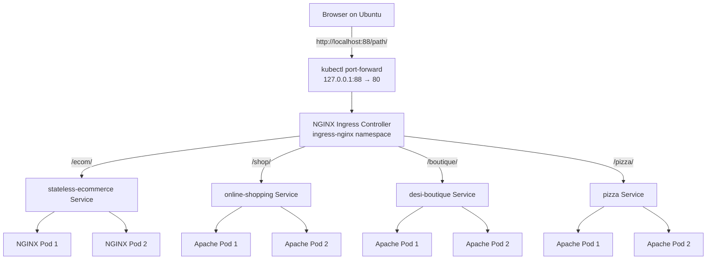

# Multi-WebApps Kubernetes Ingress

**Four websites · Eight application Pods · Three Kind nodes · One NGINX Ingress entry point**

> **Project type:** Local DevOps learning and portfolio project  
> **Environment:** Ubuntu Linux, Docker, Kind, Kubernetes, Helm and NGINX Ingress  
> **Audience:** Beginners who want to understand *what each tool does*, *why it is needed*, and *how to troubleshoot it*.

## 1. What did we build?

Imagine a shopping mall with four shops. Instead of giving every visitor a different building address, there is **one front door** and a receptionist who directs visitors to the correct shop.

Our project works the same way:

- **Four websites** are the shops.
- **Kubernetes** is the manager who keeps each shop running.
- **Pods** are the workers serving a website.
- **Services** are stable internal phone numbers for each shop.
- **NGINX Ingress** is the receptionist who reads the URL and sends the visitor to the right website.
- **Docker** packages each website so it can run consistently.
- **Kind** creates a practice Kubernetes cluster on our Ubuntu computer.

The four websites are:

| Website | URL path | Web server | Application Pods |
|---|---|---|---:|
| Stateless eCommerce | `/ecom/` | NGINX | 2 |
| Online Shopping | `/shop/` | Apache | 2 |
| Desi Boutique | `/boutique/` | Apache | 2 |
| Pizza House | `/pizza/` | Apache | 2 |

**Total: eight application Pods.** Ingress and other infrastructure Pods are not included in this number.

## 2. Project architecture



**Cluster layout:** `multi-webapps` has **one control-plane node** (the manager) and **two worker nodes** (where workloads can run). The application resources belong to the `webapps` namespace; the Ingress Controller belongs to `ingress-nginx`.

**Example request:** When you open `http://localhost:88/pizza/`, your browser reaches the local port-forward, the Ingress Controller reads `/pizza/`, sends the request to the `pizza` Service, and the Service forwards it to a ready Apache Pod.

> **Important:** `localhost:88` is a local development address, not a public internet URL. The port-forward command must remain running while you browse.

## 3. Technology explained simply

| Tool | Simple meaning | Why we used it |
|---|---|---|
| Ubuntu | Our work computer's operating system | Runs all commands and tools |
| Git / GitHub | A history book for code | Stores project files and changes |
| Docker | A portable box for an application | Builds website images |
| Kind | Kubernetes running inside Docker | Creates a local practice cluster |
| `kubectl` | Remote control for Kubernetes | Creates, inspects and fixes resources |
| Kubernetes Deployment | A manager for identical Pods | Keeps two copies of each website running |
| Pod | A running application container | Serves web requests |
| ClusterIP Service | A stable internal address | Finds ready Pods even when they change |
| EndpointSlice | A list of healthy destinations | Shows which Pod IPs a Service can reach |
| NGINX Ingress | A traffic director | Routes one entry point to four websites |
| Helm | A package manager for Kubernetes | Installs the Ingress Controller |
| NGINX / Apache | Web servers | Serve the website files |

## 4. Repository structure

```text
multi-webapps-k8s/
├── apps/
│   ├── stateless-ecommerce/
│   ├── online_shopping_app/
│   ├── desi-boutique-apache-k8s/
│   │   └── desi-boutique/
│   └── pizza-apache-k8s/
├── kind-config.yaml         # Three-node Kind cluster configuration
├── four-websites.yaml       # Namespace, Deployments and Services
├── ingress.yaml             # URL path routing rules
├── .gitignore               # Files Git should ignore
└── README.md                # This guide
```

**Use the top-level `four-websites.yaml` and `ingress.yaml` for the combined four-site deployment.** The application folders may also contain standalone manifests from earlier experiments. Paths above come from the supplied project documentation; check your checkout before running commands.

## 5. Before starting: prerequisites

Open an Ubuntu terminal. Run the commands below to see whether your tools are installed:

```bash
docker --version
kind version
kubectl version --client
helm version --short
git --version
sudo systemctl status docker --no-pager
```

**Why?** Docker must be working before Kind can create its Kubernetes nodes. The remaining tools help us create, deploy and inspect the cluster.

If a command says `command not found`, install that tool using its official installation instructions before continuing. The original project documentation does not specify the exact installation commands or tool versions, so this README does not invent them.

## 6. Step-by-step deployment: from zero to four websites

> **Commands in this section change your local development environment.** Run them only on the intended Ubuntu machine. If a cluster named `multi-webapps` already exists, do not recreate it.

### Step 1 — Get the source code

```bash
git clone https://github.com/harisamjad0158/multi-webapps-kubernetes-ingress.git
cd multi-webapps-kubernetes-ingress
ls -la
```

**What happens?** `git clone` downloads the project. `cd` enters its directory. `ls -la` lets you confirm the files exist.

> Repository URL is taken from the supplied README; confirm it is accessible and contains the expected files before following the rest of the guide.

### Step 2 — Create the three-node Kubernetes cluster

```bash
kind create cluster --name multi-webapps --config kind-config.yaml
kubectl config use-context kind-multi-webapps
kubectl get nodes -o wide
```

**Why?** Kind builds the practice cluster. `kubectl config use-context` selects it, and `kubectl get nodes` shows whether the manager and two workers are `Ready`.

**If the cluster already exists**, only run:

```bash
kubectl config use-context kind-multi-webapps
kubectl get nodes
```

### Step 3 — Build the four Docker images

```bash
docker build -t stateless-ecommerce:1.0.2 ./apps/stateless-ecommerce
docker build -t online-shopping-apache:1.0.4 ./apps/online_shopping_app
docker build -t desi-boutique-apache:1.0.1 ./apps/desi-boutique-apache-k8s/desi-boutique
docker build -t pizza-apache:1.0.1 ./apps/pizza-apache-k8s

docker image ls
```

**Why?** A Docker image is the packed website. Each image contains the files and web server needed to run that application. Check that all four image names and tags appear in `docker image ls`.

### Step 4 — Load images into Kind

```bash
kind load docker-image stateless-ecommerce:1.0.2 --name multi-webapps
kind load docker-image online-shopping-apache:1.0.4 --name multi-webapps
kind load docker-image desi-boutique-apache:1.0.1 --name multi-webapps
kind load docker-image pizza-apache:1.0.1 --name multi-webapps
```

**Why?** Images built on the Ubuntu host are not automatically available inside Kind's Kubernetes nodes. Loading them avoids image download errors for local-only images.

### Step 5 — Create the namespace and deploy the websites

```bash
kubectl create namespace webapps --dry-run=client -o yaml | kubectl apply -f -
kubectl apply -f four-websites.yaml

kubectl rollout status deployment/stateless-ecommerce -n webapps --timeout=180s
kubectl rollout status deployment/online-shopping -n webapps --timeout=180s
kubectl rollout status deployment/desi-boutique -n webapps --timeout=180s
kubectl rollout status deployment/pizza -n webapps --timeout=180s
```

**Why?** A namespace is like a labeled classroom: it keeps this project's resources together. The YAML file tells Kubernetes to create the four Deployments and Services. A Deployment keeps the desired number of Pods alive.

Check what was created:

```bash
kubectl get deployments,pods,services -n webapps -o wide
kubectl get endpointslices -n webapps
```

**Expected:** Four application Deployments, two ready Pods for each, and a Service with healthy endpoints for each application. If the output differs, use the troubleshooting section.

### Step 6 — Install the NGINX Ingress Controller

```bash
helm upgrade --install ingress-nginx ingress-nginx \
  --repo https://kubernetes.github.io/ingress-nginx \
  --namespace ingress-nginx \
  --create-namespace \
  --set controller.service.type=ClusterIP \
  --wait --timeout 5m

kubectl rollout status deployment/ingress-nginx-controller \
  -n ingress-nginx --timeout=180s
```

**Why?** Kubernetes Services work inside the cluster. The Ingress Controller receives web traffic and chooses the correct Service based on the URL path. Helm installs the controller and tracks its release.

**Compatibility note:** This is the installation method recorded in the original project. Helm repository availability and chart compatibility may change over time; check current documentation if installation fails.

### Step 7 — Apply URL routing rules

```bash
kubectl apply -f ingress.yaml
kubectl get ingress -n webapps
kubectl describe ingress multi-webapps-ingress -n webapps
```

**Why?** The Ingress rules are like four signs on a hallway: `/ecom/`, `/shop/`, `/boutique/` and `/pizza/`. Each sign points to a different Service.

**Important:** The original configuration expects each web application to understand its own URL prefix. Do not blindly add an Ingress rewrite rule; it can break CSS, images and links.

### Step 8 — Open the websites on Ubuntu

Keep this command running in a **separate terminal**:

```bash
kubectl port-forward -n ingress-nginx \
  deployment/ingress-nginx-controller \
  88:80 --address=127.0.0.1
```

Now open these addresses in the Ubuntu browser:

| Website | Browser URL |
|---|---|
| eCommerce | http://localhost:88/ecom/ |
| Online Shopping | http://localhost:88/shop/ |
| Desi Boutique | http://localhost:88/boutique/ |
| Pizza House | http://localhost:88/pizza/ |

**Why two terminals?** The first terminal keeps the connection open; the second can run test commands. Press `Ctrl+C` in the port-forward terminal when you are finished browsing.

## 7. How Kubernetes keeps the websites running

A Deployment says, for example, **“I want two eCommerce Pods.”** If a Pod crashes or disappears, Kubernetes tries to create a replacement. The Service continues to offer a stable address and sends requests to ready endpoints.

This is called **self-healing**. It helps with Pod failures, but it does not guarantee availability during every possible node or cluster failure.

## 8. Testing stages

These are the validation procedures described in the original README. The original text includes commands and expected results but does **not** include complete execution logs for every test, so the outcomes below are **expected results**, not independently verified historical passes.

### Test A — Check all four web routes (non-destructive)

Start the port-forward from Step 8, then run:

```bash
for path in ecom shop boutique pizza; do
  curl -sS --max-time 10 -o /dev/null \
    -w "$path: HTTP %{http_code}, Total Time: %{time_total}s\n" \
    "http://127.0.0.1:88/$path/"
done
```

**Expected:** Each path returns `HTTP 200`. `HTTP 000` generally means the request could not connect; `404` may indicate a routing/path issue; `503` can indicate an unavailable backend.

### Test B — Check Deployment and Pod health (non-destructive)

```bash
kubectl get deployments -n webapps
kubectl get pods -n webapps -o wide
kubectl get services,endpointslices -n webapps
```

**Expected:** Each Deployment has `2/2` ready replicas, and its Service has ready Pod endpoints.

### Test C — Demonstrate self-healing (intentionally disruptive)

> **Practice-cluster only:** This deletes one running eCommerce Pod. Kubernetes should replace it. Do not run this in a production cluster.

```bash
TARGET_POD=$(kubectl get pods -n webapps \
  -l app=stateless-ecommerce \
  -o jsonpath='{.items[0].metadata.name}')

test -n "$TARGET_POD" || { echo 'No matching Pod found'; exit 1; }
kubectl delete pod -n webapps "$TARGET_POD"
kubectl rollout status deployment/stateless-ecommerce -n webapps --timeout=180s
kubectl get pods -n webapps
```

**Expected:** A replacement Pod appears and the Deployment returns to its desired replica count.

### Test D — Demonstrate manual scaling (changes replica count)

> **Practice-cluster only:** This temporarily changes the eCommerce Deployment from two to three Pods and then restores two.

```bash
kubectl scale deployment/stateless-ecommerce -n webapps --replicas=3
kubectl rollout status deployment/stateless-ecommerce -n webapps
kubectl get pods -n webapps -l app=stateless-ecommerce

kubectl scale deployment/stateless-ecommerce -n webapps --replicas=2
kubectl rollout status deployment/stateless-ecommerce -n webapps
```

**Expected:** Three ready replicas, followed by two ready replicas after restoration.

**HPA versus manual scaling:** This project demonstrates **manual scaling** with `kubectl scale`. The supplied README does **not** document HPA or VPA configuration. Do not describe this project as having automatic HPA/VPA scaling without adding and testing those components.

### Test E — Inspect Ingress routing (non-destructive)

```bash
kubectl describe ingress multi-webapps-ingress -n webapps
kubectl logs -n ingress-nginx deployment/ingress-nginx-controller --tail=100
```

**Expected:** Four configured routes and controller logs useful for diagnosing requests.

## 9. Troubleshooting: problems and how to investigate them

Troubleshooting is like solving a puzzle: **observe the symptom → inspect the correct layer → identify the cause → apply a focused fix → test again.**

The following cases are documented in the original README as troubleshooting scenarios. They should not all be interpreted as confirmed incidents unless corresponding terminal logs exist.

| Symptom | Plain-English explanation | Check / suggested fix |
|---|---|---|
| `HTTP 000` or connection timeout | Browser cannot reach the local entry point | Confirm the port-forward terminal is still running; retry `curl` |
| `bind: address already in use` | Another program already owns port 88 | Run `sudo ss -ltnp 'sport = :88'`; choose a free port or stop the correct old process |
| `ImagePullBackOff` | Kubernetes cannot find/download the image | Check image name and tag; load local image with `kind load docker-image ...` |
| `CrashLoopBackOff` | Container starts and repeatedly exits | Inspect `kubectl logs -n webapps POD_NAME --previous` and `kubectl describe pod` |
| Service has no endpoints | Service selector does not match ready Pods | Compare Service selectors and Pod labels; inspect EndpointSlices |
| Ingress returns `404` | The URL path is not matching the expected rule | Inspect `kubectl describe ingress ...`; verify the trailing slash and path |
| Ingress returns `503` | Controller cannot reach a healthy backend | Check Deployment readiness, Service port, selector and EndpointSlices |
| Website loads but CSS/images fail | Asset paths may not match `/shop/` or another prefix | Inspect browser network requests and the site's base path; avoid blind rewrites |
| Wrong cluster selected | Commands target a different Kubernetes environment | Run `kubectl config current-context` and select `kind-multi-webapps` |

### Troubleshooting walkthrough 1 — Port 88 is already occupied

**Symptom:** `Unable to listen on port 88: bind: address already in use`.

1. Find what is listening:

   ```bash
   sudo ss -ltnp 'sport = :88'
   ```

2. If it is an old `kubectl port-forward`, stop **that specific process** after checking its PID. Do not kill an unknown service.
3. Alternatively, choose another local port:

   ```bash
   kubectl port-forward -n ingress-nginx \
     deployment/ingress-nginx-controller 8088:80 --address=127.0.0.1
   ```

4. Open `http://localhost:8088/ecom/` and retest.

### Troubleshooting walkthrough 2 — ImagePullBackOff

**Symptom:** A Pod stays in `ImagePullBackOff` or `ErrImagePull`.

1. Check the exact error:

   ```bash
   kubectl get pods -n webapps
   kubectl describe pod -n webapps POD_NAME
   ```

2. Compare the Deployment image name and tag with `docker image ls`.
3. If the image exists only on Ubuntu, load it into Kind:

   ```bash
   kind load docker-image stateless-ecommerce:1.0.2 --name multi-webapps
   ```

4. Recheck the Deployment rollout. Also verify `imagePullPolicy` is suitable for locally loaded images.

### Troubleshooting walkthrough 3 — CrashLoopBackOff

**Symptom:** The Pod repeatedly restarts.

```bash
kubectl logs -n webapps POD_NAME --previous
kubectl describe pod -n webapps POD_NAME
```

Look for errors such as wrong server configuration, missing files, permission problems or the application listening on a different port. Fix the underlying image or manifest, redeploy and confirm the Pod stays ready.

### Troubleshooting walkthrough 4 — Service has no endpoints

**Symptom:** The Service exists, but no website Pods receive traffic.

```bash
kubectl get svc -n webapps
kubectl get pods -n webapps --show-labels
kubectl get endpointslices -n webapps
kubectl describe svc stateless-ecommerce -n webapps
```

A Service finds Pods using **labels**. For example, if the Service selects `app=stateless-ecommerce` but the Pods use another label, they will not match. Fix the selector or Pod labels in the YAML, then apply the corrected manifest.

### Troubleshooting walkthrough 5 — Ingress returns 404 or 503

```bash
kubectl describe ingress multi-webapps-ingress -n webapps
kubectl get svc,pods,endpointslices -n webapps
kubectl logs -n ingress-nginx deployment/ingress-nginx-controller --tail=100
```

- **404:** First check the URL path and Ingress routing rules.
- **503:** First check whether the backend Service has ready endpoints.
- **Missing CSS/images:** Check whether the website uses paths such as `/assets/...` when it should use a prefix like `/pizza/assets/...`.

After any fix, rerun the four-route HTTP smoke test.

## 10. One-block read-only health check

**Run this entire block** when you want to inspect the project without changing its resources:

```bash
set -e
kubectl config current-context
kubectl get nodes
kubectl get deployments,pods,services -n webapps
kubectl get endpointslices -n webapps
kubectl get ingress -n webapps
kubectl get deployment -n ingress-nginx ingress-nginx-controller
helm list -n ingress-nginx
```

**Why?** This checks the cluster, applications, Service destinations, routing and Ingress installation in one place.

## 11. What did we learn?

1. How Docker turns website files into runnable container images.
2. How Kind creates a local multi-node Kubernetes cluster.
3. Why images must be loaded into Kind when they are only available locally.
4. How Deployments keep the requested number of Pods running.
5. How Services provide stable access to changing Pod IP addresses.
6. How Ingress routes different URL paths to different websites.
7. How to use `kubectl`, logs, EndpointSlices and HTTP status codes to find problems.
8. How to test Pod self-healing and manual scaling in a safe practice environment.

## 12. What is not part of the documented implementation?

The original project description does **not** establish the following as completed features: HPA/VPA autoscaling, HTTPS/TLS, external public DNS, Prometheus/Grafana monitoring, an automated CI/CD pipeline, or a remote image registry. These are possible future improvements, not verified achievements of this project.

## 13. Future improvements

- Add GitHub Actions to automatically test and build images.
- Push versioned images to a container registry and pin deployment image digests.
- Add HTTPS with a trusted certificate and an appropriate DNS name.
- Add Prometheus and Grafana for metrics and dashboards.
- Add CPU/memory requests and limits, resource quotas, and NetworkPolicies.
- Optionally introduce HPA and VPA, then test them separately.
- Add automated end-to-end HTTP tests in CI.

## 14. Cleanup (destructive — optional)

**Stop the port-forward** with `Ctrl+C` first.

To remove the application resources while keeping the cluster:

```bash
kubectl delete -f ingress.yaml
kubectl delete -f four-websites.yaml
```

To delete the entire practice cluster, including all workloads and its local cluster data:

```bash
kind delete cluster --name multi-webapps
```

> **Warning:** Cluster deletion is destructive. Do not run it if you want to keep the environment for more practice.

## 15. Project summary for GitHub and interviews

> **Multi-WebApps Kubernetes Ingress:** Built a local three-node Kind cluster on Ubuntu and deployed four independent containerized web applications using Docker and Kubernetes. Configured eight application replicas, ClusterIP Services and NGINX Ingress path-based routing. Documented local access, rollout checks, HTTP smoke testing, Pod self-healing, manual scaling and troubleshooting of image, Service and Ingress issues.

## 16. Useful command cheat sheet

| Command | Meaning |
|---|---|
| `docker image ls` | Show images built on Ubuntu |
| `kind get clusters` | Show local Kind clusters |
| `kubectl get nodes` | Show Kubernetes machines |
| `kubectl get pods -n webapps` | Show running application Pods |
| `kubectl get svc -n webapps` | Show internal Service addresses |
| `kubectl get endpointslices -n webapps` | Show Service destinations |
| `kubectl get ingress -n webapps` | Show website routing rules |
| `kubectl describe pod POD -n webapps` | Explain Pod status and events |
| `kubectl logs POD -n webapps` | Read application output |
| `helm list -n ingress-nginx` | Show installed Ingress Helm release |

---

**Documentation note:** This README is based on the user-provided Multi-WebApps project guide. It preserves its recorded resource names, paths and image tags, while expanding explanations and troubleshooting. It is not a claim that every test command was executed successfully in the current cluster. Review repository files and tool compatibility before using it as a fresh-install runbook.
